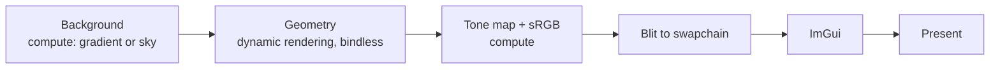

# vk-playground

A Vulkan 1.3 renderer for learning and experimenting with modern GPU techniques. It started from [vkguide.dev](https://vkguide.dev) and has since grown its own frame structure, synchronization and tooling.

<!-- Add a screenshot: docs/screenshot.png -->

## What it does

- **Modern Vulkan 1.3:** dynamic rendering, synchronization2, and a timeline semaphore that keeps two frames in flight.
- **Vertex pulling:** shaders read vertices through buffer device addresses, so there is no vertex input state. Each glTF file shares one vertex buffer and one index buffer.
- **Bindless textures:** materials index a global array of textures.
- **HDR pipeline:** an HDR (`R16G16B16A16_SFLOAT`) draw target, reversed-Z depth, tone mapping, and an sRGB transfer function in compute.
- **CPU frustum culling and draw sorting:** objects are sorted by material and mesh to minimize state changes.
- **Per-pass GPU timings** from timestamp queries, plus debug labels for RenderDoc and Nsight captures.
- **Model loading:** glTF scenes through [fastgltf](https://github.com/spnda/fastgltf), and OBJ, FBX and other formats through [Assimp](https://github.com/assimp/assimp) from **File → Load**.
- **RAII resource handling:** GPU buffers and images free themselves through a per-frame deferred-destruction list, so nothing is destroyed while the GPU might still use it.

## Frame structure



Each stage writes a timestamp, and the **Stats** window shows its GPU time.

## Building

Requirements:

- Windows with Visual Studio 2022 or newer. CLion with the MSVC toolchain also works.
- [Vulkan SDK](https://vulkan.lunarg.com/) 1.3 or newer. It includes `slangc`, which compiles the shaders and must be on your `PATH`.
- [vcpkg](https://github.com/microsoft/vcpkg) with `CMAKE_TOOLCHAIN_FILE` pointing at its `scripts/buildsystems/vcpkg.cmake`. The dependencies are listed in `vcpkg.json`.

```sh
cmake -B build -G Ninja -DCMAKE_BUILD_TYPE=RelWithDebInfo -DCMAKE_TOOLCHAIN_FILE=<vcpkg>/scripts/buildsystems/vcpkg.cmake
cmake --build build --target demo
```

The build compiles every `shaders/*.slang` file to `spirv/` and puts the executable in `bin/`.

Validation layers are on in Debug builds and off in Release and RelWithDebInfo.

### Assets

`assets/` isn't checked in. The default scene loads `assets/structure.glb` from the `assets` folder of the [vkguide repository](https://github.com/vblanco20-1/vulkan-guide). Put it in `assets/` at the repository root.

### omp code intelligence

`.omp/lsp.json` resolves standalone `clangd` from `PATH` and uses the compilation database in `cmake-build-relwithdebinfo-visual-studio`, matching CLion's RelWithDebInfo profile. Install LLVM/clangd on each machine and generate that build directory with `-DCMAKE_EXPORT_COMPILE_COMMANDS=ON` before using the LSP. If you use another build directory, update `--compile-commands-dir` accordingly.

After changing the configuration, reload omp's native LSP with `action: "reload", file: "*"`. clangd runs independently of CLion; the separate CLion MCP connection requires the IDE to remain open.

If clangd is not on `PATH`, create an ignored root `.lsp.json` containing a machine-local executable override; root LSP configuration takes precedence over `.omp/lsp.json`:

```json
{
  "servers": {
    "clangd": {
      "command": "C:/path/to/LLVM/bin/clangd.exe"
    }
  }
}
```

The project instructions, rules, skills, and portable `.omp/lsp.json` belong in Git. `.omp/mcp.json` stays ignored: configure CLion MCP separately on each machine using that IDE's current endpoint and local project path. Generated build trees (`cmake-build-*/`, `build/`, `out/`), binaries, compiled shaders, dependency installations, and IDE workspace state stay local; do not delete them merely to prepare a commit.

Project conventions and verification entry points are in [`.omp/AGENTS.md`](.omp/AGENTS.md). The [renderer-check skill](.omp/skills/renderer-check/SKILL.md) covers Debug validation, visual/lifecycle checks, and optional optimized performance comparisons. After starting or restarting omp to discover the skill, invoke `/skill:renderer-check` with the feature or scenario to exercise.

The [vulkan-review skill](.omp/skills/vulkan-review/SKILL.md) traces synchronization, resource ownership, barriers, and frame/swapchain lifetimes before targeted renderer verification. After restarting omp to discover it, use `/skill:vulkan-review review swapchain recreation and semaphore retirement`. It is read-only by default and reports concrete findings rather than applying fixes.

### Renderer smoke check

From the repository root on an interactive Windows desktop:

```powershell
powershell.exe -NoProfile -ExecutionPolicy Bypass -File scripts/renderer-smoke.ps1 -Profile Debug
```

Requires Windows PowerShell 5.1 or PowerShell 7, CMake on `PATH`, the existing selected CMake build directory, its MSVC/Vulkan SDK toolchain, and `assets/structure.glb`. The harness derives `vcvarsall.bat` from the cached compiler; pass `-VcVarsAll <path>` if needed. It uses built-in Windows/.NET APIs, not Python packages.

The harness relinks the selected profile, captures build and renderer logs, saves screenshots before/after shrink, expand, and minimize/restore, then closes its own window normally. It refuses existing `demo.exe` processes, serializes other harness runs, and restores saved ImGui settings. Do not run an IDE build concurrently: profiles share `bin/`, and external builds do not participate in the harness lock.

The printed evidence directory contains `report.json`, stdout/stderr logs, and four PNGs. Inspect the screenshots and exercise feature-specific UI separately; capture success alone is not visual proof. By default evidence goes to a new directory under Windows temporary storage; use `-OutputDirectory <new-path>` to retain it elsewhere, or `-SettleSeconds <1-30>` for slower machines. Review evidence before deleting it.

Exit codes: **0** automated checks passed, **1** prerequisite/build failure, **2** runtime/capture/cleanup failure, **3** validation errors despite successful runtime checks. Runtime/build failures take precedence over validation failure. Warnings remain in the report/logs; repeated validation output may be capped by the layer. `-Profile RelWithDebInfo` is an additional optimized check and never reports validation as passed.

The Debug smoke check currently exposes presentation synchronization and in-use swapchain/semaphore destruction errors. A successful launch/exit is not a validation pass; the harness does not suppress those diagnostics.

## Controls

| Input | Action |
|---|---|
| `W` `A` `S` `D` | Move |
| Mouse | Look around |
| **File → Load** | Import a model (OBJ, FBX, glTF and others) |
| **Stats** window | CPU and per-pass GPU timings, triangle and draw counts, and the present mode (FIFO, MAILBOX or IMMEDIATE) |
| **background** window | Switch the background effect and edit its parameters, the sun color and the sun direction |

## Project layout

| Path | Contents |
|---|---|
| `src/vk_engine.*` | `VulkanEngine`: device setup, swapchain, per-frame resources, and the frame loop |
| `src/vk_loader.*` | glTF loading into meshes, materials and a scene-node hierarchy |
| `src/gpu_profiler.*` | Timestamp queries and debug labels for each pass |
| `src/model/` | Assimp model import |
| `src/app/` | Application loop and the ImGui editor UI |
| `shared/` | Reusable Vulkan helpers: initializers, image transitions and blits, pipeline and descriptor builders, the camera, and the core types |
| `shaders/` | Slang shaders. A file ending in `_comp` is a compute shader. Other files define `vertexMain` and/or `fragmentMain`. |
| `docs/` | Design notes and improvement plans |

## License

MIT. See [LICENSE.txt](LICENSE.txt).
