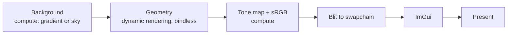

# vk-playground

A Vulkan 1.3 renderer for learning and experimenting with modern GPU techniques. It started from [vkguide.dev](https://vkguide.dev) and has since grown its own frame structure, synchronization and tooling.

<!-- Add a screenshot: docs/screenshot.png -->

## What it does

- **Modern Vulkan 1.3:** dynamic rendering, synchronization2, and a timeline semaphore that keeps two frames in flight.
- **Vertex pulling:** shaders read vertices through buffer device addresses, so there is no vertex input state. Each glTF file shares one vertex buffer and one index buffer.
- **Bindless textures:** materials index a global array of textures.
- **HDR pipeline:** an HDR (`R16G16B16A16_SFLOAT`) draw target, reversed-Z depth, tone mapping, and an sRGB transfer function in compute.
- **CPU frustum culling and draw sorting:** objects are sorted by material and mesh to minimize state changes.
- **Per-pass GPU timings** from timestamp queries, plus debug labels for RenderDoc and Nsight captures.
- **Model loading:** glTF scenes through [fastgltf](https://github.com/spnda/fastgltf), and OBJ, FBX and other formats through [Assimp](https://github.com/assimp/assimp) from **File → Load**.
- **RAII resource handling:** GPU buffers and images free themselves through a per-frame deferred-destruction list, so nothing is destroyed while the GPU might still use it.

## Frame structure



Each stage writes a timestamp, and the **Stats** window shows its GPU time.

## Building

Requirements:

- Windows with Visual Studio 2022 or newer. CLion with the MSVC toolchain also works.
- [Vulkan SDK](https://vulkan.lunarg.com/) 1.3 or newer. It includes `slangc`, which compiles the shaders and must be on your `PATH`.
- [vcpkg](https://github.com/microsoft/vcpkg) with `CMAKE_TOOLCHAIN_FILE` pointing at its `scripts/buildsystems/vcpkg.cmake`. The dependencies are listed in `vcpkg.json`.

```sh
cmake -B build -G Ninja -DCMAKE_BUILD_TYPE=RelWithDebInfo -DCMAKE_TOOLCHAIN_FILE=<vcpkg>/scripts/buildsystems/vcpkg.cmake
cmake --build build --target demo
```

The build compiles every `shaders/*.slang` file to `spirv/` and puts the executable in `bin/`.

Validation layers are on in Debug builds and off in Release and RelWithDebInfo.

### Assets

`assets/` isn't checked in. The default scene loads `assets/structure.glb` from the `assets` folder of the [vkguide repository](https://github.com/vblanco20-1/vulkan-guide). Put it in `assets/` at the repository root.

## Controls

| Input | Action |
|---|---|
| `W` `A` `S` `D` | Move |
| Mouse | Look around |
| **File → Load** | Import a model (OBJ, FBX, glTF and others) |
| **Stats** window | CPU and per-pass GPU timings, triangle and draw counts, and the present mode (FIFO, MAILBOX or IMMEDIATE) |
| **background** window | Switch the background effect and edit its parameters, the sun color and the sun direction |

## Project layout

| Path | Contents |
|---|---|
| `src/vk_engine.*` | `VulkanEngine`: device setup, swapchain, per-frame resources, and the frame loop |
| `src/vk_loader.*` | glTF loading into meshes, materials and a scene-node hierarchy |
| `src/gpu_profiler.*` | Timestamp queries and debug labels for each pass |
| `src/model/` | Assimp model import |
| `src/app/` | Application loop and the ImGui editor UI |
| `shared/` | Reusable Vulkan helpers: initializers, image transitions and blits, pipeline and descriptor builders, the camera, and the core types |
| `shaders/` | Slang shaders. A file ending in `_comp` is a compute shader. Other files define `vertexMain` and/or `fragmentMain`. |
| `docs/` | Design notes and improvement plans |

## License

MIT. See [LICENSE.txt](LICENSE.txt).
