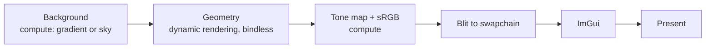

# vk-playground

A Vulkan 1.3 renderer for learning and experimenting with modern GPU techniques. It started from [vkguide.dev](https://vkguide.dev) and has since grown its own frame structure, synchronization and tooling.

<!-- Add a screenshot: docs/screenshot.png -->

## What it does

- **Modern Vulkan 1.3:** dynamic rendering, synchronization2, and a timeline semaphore that keeps two frames in flight.
- **Vertex pulling:** shaders read vertices through buffer device addresses, so there is no vertex input state. Each glTF file shares one vertex buffer and one index buffer.
- **Bindless textures:** materials index a global array of textures.
- **HDR pipeline:** an HDR (`R16G16B16A16_SFLOAT`) draw target, reversed-Z depth, tone mapping, and an sRGB transfer function in compute.
- **CPU frustum culling and draw sorting:** objects are sorted by material and mesh to minimize state changes.
- **Per-pass GPU timings** from timestamp queries, plus debug labels for RenderDoc and Nsight captures.
- **Model loading:** glTF scenes through [fastgltf](https://github.com/spnda/fastgltf), and OBJ, FBX and other formats through [Assimp](https://github.com/assimp/assimp) from **File → Load**.
- **RAII resource handling:** GPU buffers and images free themselves through a per-frame deferred-destruction list, so nothing is destroyed while the GPU might still use it.

## Frame structure



Each stage writes a timestamp, and the **Stats** window shows its GPU time.

## Building

Requirements:

- Windows with Visual Studio 2022 or newer. CLion with the MSVC toolchain also works.
- CMake 3.21 or newer.
- [Vulkan SDK](https://vulkan.lunarg.com/) 1.3 or newer. It includes `slangc`, which compiles the shaders and must be on your `PATH`.
- Presentation retirement requires `VK_EXT_swapchain_maintenance1` with `swapchainMaintenance1`, plus the instance extensions `VK_EXT_surface_maintenance1` and `VK_KHR_get_surface_capabilities2`. Vulkan 1.3 alone does not guarantee these; use SDK headers that include them.
- [vcpkg](https://github.com/microsoft/vcpkg) with `CMAKE_TOOLCHAIN_FILE` pointing at its `scripts/buildsystems/vcpkg.cmake`. The dependencies are listed in `vcpkg.json`.

```sh
cmake -B build -G Ninja -DCMAKE_BUILD_TYPE=RelWithDebInfo -DCMAKE_TOOLCHAIN_FILE=<vcpkg>/scripts/buildsystems/vcpkg.cmake
cmake --build build --target demo
```

The build compiles every `shaders/*.slang` file to `spirv/` and puts the executable in `bin/`. Building `demo` also stages the compiled shaders in `bin/spirv/` and the default scene in `bin/assets/structure.glb`, including on incremental builds that do not relink the executable.

Validation layers are on in Debug builds and off in Release and RelWithDebInfo.

### Assets

`assets/` isn't checked in. Ordinary local builds use `assets/structure.glb` at the repository root, or the file selected by the `DEMO_SCENE_FILE` CMake cache entry. The original reactor model is available in the [Vulkan Guide tutorial branch](https://github.com/vblanco20-1/vulkan-guide/tree/all-chapters-2/assets), but its redistribution permission has not been established. The adjacent Lost Empire copyright notice describes a different model; do not use it to license the reactor.

Demo packaging instead downloads the CC0 **Tomb Chaser 1 — Layout Floor 01** scene by Polygonal Mind from a pinned GLB conversion collection revision. The URL, SHA256, license evidence and placement are recorded in [`packaging/demo-scene.json`](packaging/demo-scene.json). Your local `assets/structure.glb` is never overwritten.

### Runtime resources

The application locates `assets/` and `spirv/` beside `demo.exe`, not in the source checkout or relative to the launch working directory. To relocate a local build, keep `demo.exe`, its required runtime DLLs, `assets/structure.glb`, and the `spirv/` folder together. Other local models are not staged automatically; open them through **File → Load**.

Startup checks the default scene and the shader files generated by CMake before creating GPU resources. A missing file reports its resolved path to stderr and exits with code 1. A scene that cannot be loaded also reports its path and exits with code 1 after cleaning up the initialized renderer.

### Windows demo ZIP

Configure a Windows x64 MSVC build tree with the `x64-windows` vcpkg triplet and Vulkan SDK/Slang first (see Building). The wrapper uses an existing configured tree; it initializes that compiler's x64 developer environment itself:

```powershell
powershell.exe -NoProfile -ExecutionPolicy Bypass -File scripts/package-demo.ps1 -Version v0.1.0
# For a differently named configured build tree:
powershell.exe -NoProfile -ExecutionPolicy Bypass -File scripts/package-demo.ps1 -BuildDirectory build -Version v0.1.0
```

Requires Windows PowerShell 5.1 or PowerShell 7, CMake and Git on PATH. The default build tree is `cmake-build-relwithdebinfo-visual-studio`; `-Configuration Release` is also supported when the tree matches. Debug packages are refused because Debug CRT files are not distributable. Use `-VcVarsAll <path>` if MSVC setup cannot be derived from the cached compiler.

The command fetches and verifies the licensed scene in the build tree's `demo-assets/`, adds a placement parent node for the existing camera, configures `DEMO_SCENE_FILE`/source/checksum entries, forces the selected executable to relink, and installs only CMake's `Demo` component into a fresh staging directory. Geometry, textures and GLB binary chunks are unchanged. Subsequent builds in that tree keep the packaged scene; to return to the local reactor, reconfigure with `-DDEMO_SCENE_FILE=<repo>/assets/structure.glb`.

Outputs go to `out/packages/` (`-OutputDirectory` overrides it):
- `vk-playground-<version>-windows-x64.zip`, containing the executable, required dependency DLLs, release MSVC CRT DLLs, compiled shaders, licensed scene, notices, run instructions and build identity.
- A matching `.zip.sha256` checksum; existing packages are never overwritten.
- Build/install logs in a printed `.work-*` evidence directory. Failed runs retain diagnostics but do not publish a ZIP.

If `-Version` is omitted, the label includes the Git commit and a `-dirty` suffix when appropriate. `build-info.txt` records the commit, working-tree state, configuration and original/prepared scene hashes. The scene input is pinned and the packaging procedure is repeatable; timestamps, the selected local toolchain and source changes mean this is **not** a bit-for-bit reproducible-build claim.

Do not run IDE builds concurrently. Packaging shares the smoke harness mutex and refuses existing `demo.exe` processes, but cannot lock external IDE builds. Dependency projects have their own SDK install rules: use the wrapper's `--component Demo` installation, not an unrestricted install or a ZIP of `bin/`.

Recipients extract the entire archive and run `demo.exe`. They need a compatible Vulkan 1.3 GPU/driver with the required descriptor, device-address, timeline, push-descriptor and swapchain-maintenance features (detailed in the packaged README); they do not need build tools or the Vulkan SDK. The system Vulkan loader/driver is not bundled. This executable is unsigned; Windows may display reputation warnings.

Before sharing, smoke-check the **extracted archive** outside the checkout, inspect actual rendering, resize/minimize/restore, and close normally. Use Debug with validation separately; an optimized ZIP passing compilation or launch does not prove Vulkan correctness.

See [the demo distribution plan](docs/DEMO_DISTRIBUTION_PLAN.md) for completed changes, verification evidence, remaining GitHub Actions/release work, and acceptance criteria.

### GitHub development builds and draft releases

The **Windows demo build** workflow runs for PRs targeting `master`, pushes to `master`, and manual dispatches. Open [Actions](https://github.com/jperez01/vk-playground/actions/workflows/build-windows.yml), select a successful run, and download its `windows-x64-<commit>` artifact. Unzip the Actions artifact first, then extract the demo ZIP inside it. GitHub sign-in is required for Actions downloads; artifacts and separate diagnostic logs are retained for 14 days.

The workflows use `windows-2022`, enforce the VS2022 MSVC 14.44 family, and provision checksum-pinned Vulkan SDK/Slang, CMake and Ninja versions plus a pinned vcpkg checkout. Full compiler version/toolchain evidence accompanies each run; the runner image itself can receive updates. Development jobs have read-only repository permissions, including PR jobs.

To prepare a release, create and push a version tag such as `v0.1.0` for the intended commit. The **Windows demo draft release** workflow builds that tag through the same packaging command, verifies its ZIP/checksum and source identity, and creates a **draft** under [Releases](https://github.com/jperez01/vk-playground/releases). Tags must be `vMAJOR.MINOR.PATCH` with an optional SemVer prerelease suffix; prerelease tags produce draft prereleases. Existing releases are not overwritten on a rerun.

Download and verify the exact candidate on supported GPU hardware before manually publishing the draft. CI proves build/package automation, not rendering or Vulkan correctness. Only the final publishing job has release-write permission; it does not build or execute downloaded package contents. Manual dispatch becomes available after the workflow exists on `master`.


### omp code intelligence

`.omp/lsp.json` resolves standalone `clangd` from `PATH` and uses the compilation database in `cmake-build-relwithdebinfo-visual-studio`, matching CLion's RelWithDebInfo profile. Install LLVM/clangd on each machine and generate that build directory with `-DCMAKE_EXPORT_COMPILE_COMMANDS=ON` before using the LSP. If you use another build directory, update `--compile-commands-dir` accordingly.

After changing the configuration, reload omp's native LSP with `action: "reload", file: "*"`. clangd runs independently of CLion; the separate CLion MCP connection requires the IDE to remain open.

If clangd is not on `PATH`, create an ignored root `.lsp.json` containing a machine-local executable override; root LSP configuration takes precedence over `.omp/lsp.json`:

```json
{
  "servers": {
    "clangd": {
      "command": "C:/path/to/LLVM/bin/clangd.exe"
    }
  }
}
```

The project instructions, rules, skills, and portable `.omp/lsp.json` belong in Git. `.omp/mcp.json` stays ignored: configure CLion MCP separately on each machine using that IDE's current endpoint and local project path. Generated build trees (`cmake-build-*/`, `build/`, `out/`), binaries, compiled shaders, dependency installations, and IDE workspace state stay local; do not delete them merely to prepare a commit.

Project conventions and verification entry points are in [`.omp/AGENTS.md`](.omp/AGENTS.md). The [renderer-check skill](.omp/skills/renderer-check/SKILL.md) covers Debug validation, visual/lifecycle checks, and optional optimized performance comparisons. After starting or restarting omp to discover the skill, invoke `/skill:renderer-check` with the feature or scenario to exercise.

The [vulkan-review skill](.omp/skills/vulkan-review/SKILL.md) traces synchronization, resource ownership, barriers, and frame/swapchain lifetimes before targeted renderer verification. After restarting omp to discover it, use `/skill:vulkan-review review swapchain recreation and semaphore retirement`. It is read-only by default and reports concrete findings rather than applying fixes.

### Renderer smoke check

From the repository root on an interactive Windows desktop:

```powershell
powershell.exe -NoProfile -ExecutionPolicy Bypass -File scripts/renderer-smoke.ps1 -Profile Debug
```

Requires Windows PowerShell 5.1 or PowerShell 7, CMake on `PATH`, the existing selected CMake build directory, its MSVC/Vulkan SDK toolchain, and `assets/structure.glb`. The harness derives `vcvarsall.bat` from the cached compiler; pass `-VcVarsAll <path>` if needed. It uses built-in Windows/.NET APIs, not Python packages.

The harness relinks the selected profile, captures build and renderer logs, saves screenshots before/after shrink, expand, and minimize/restore, then closes its own window normally. It refuses existing `demo.exe` processes, serializes other harness runs, and restores saved ImGui settings. Do not run an IDE build concurrently: profiles share `bin/`, and external builds do not participate in the harness lock.

The printed evidence directory contains `report.json`, stdout/stderr logs, and four PNGs. Inspect the screenshots and exercise feature-specific UI separately; capture success alone is not visual proof. By default evidence goes to a new directory under Windows temporary storage; use `-OutputDirectory <new-path>` to retain it elsewhere, or `-SettleSeconds <1-30>` for slower machines. Review evidence before deleting it.

Exit codes: **0** automated checks passed, **1** prerequisite/build failure, **2** runtime/capture/cleanup failure, **3** validation errors despite successful runtime checks. Runtime/build failures take precedence over validation failure. Warnings remain in the report/logs; repeated validation output may be capped by the layer. `-Profile RelWithDebInfo` is an additional optimized check and never reports validation as passed.

The 2026-10-31 Debug checks on an RTX 5070 Ti reported zero validation errors after the synchronization and presentation-retirement fixes. Resize/minimize/restore, present-mode changes, background switching, model import/replacement and normal shutdown were exercised. External layer-name and small-allocation performance warnings remain; this is not a guarantee for untested GPUs or release artifacts. See [validation evidence and coverage](docs/VALIDATION_HANDOFF.md).

## Controls

| Input | Action |
|---|---|
| `W` `A` `S` `D` | Move |
| Mouse | Look around |
| **File → Load** | Import a model (OBJ, FBX, glTF and others) |
| **Stats** window | CPU and per-pass GPU timings, triangle and draw counts, and the present mode (FIFO, MAILBOX or IMMEDIATE) |
| **background** window | Switch the background effect and edit its parameters, the sun color and the sun direction |

## Project layout

| Path | Contents |
|---|---|
| `src/vk_engine.*` | `VulkanEngine`: device setup, swapchain, per-frame resources, and the frame loop |
| `src/vk_loader.*` | glTF loading into meshes, materials and a scene-node hierarchy |
| `src/gpu_profiler.*` | Timestamp queries and debug labels for each pass |
| `src/model/` | Assimp model import |
| `src/app/` | Application loop and the ImGui editor UI |
| `shared/` | Reusable Vulkan helpers: initializers, image transitions and blits, pipeline and descriptor builders, the camera, and the core types |
| `shaders/` | Slang shaders. A file ending in `_comp` is a compute shader. Other files define `vertexMain` and/or `fragmentMain`. |
| `docs/` | Design notes and improvement plans |

## License

MIT. See [LICENSE.txt](LICENSE.txt).
